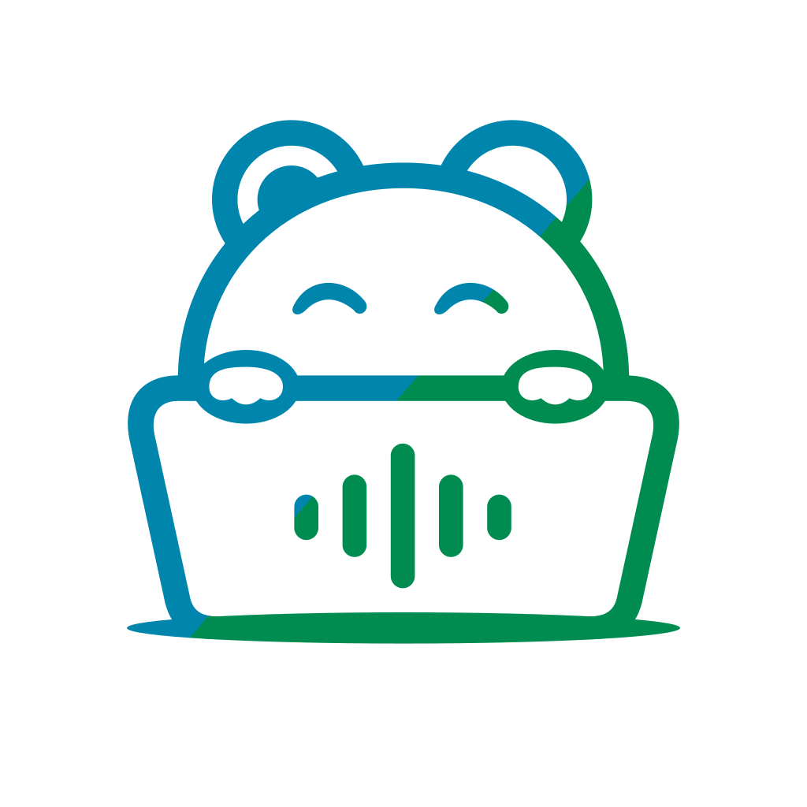
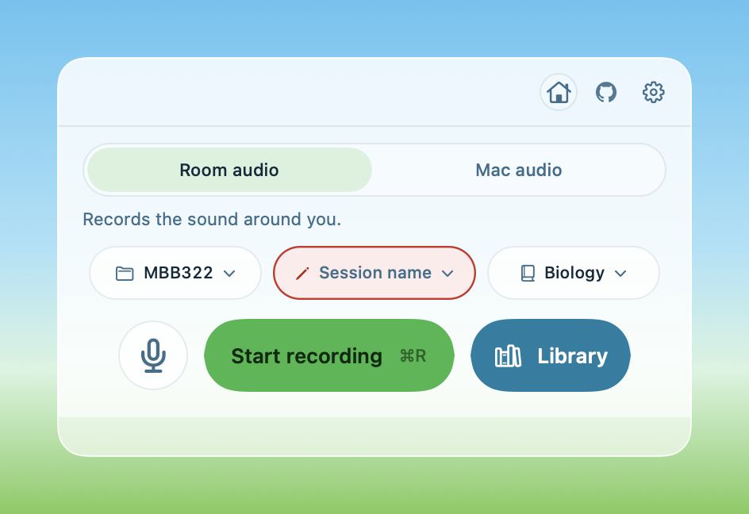
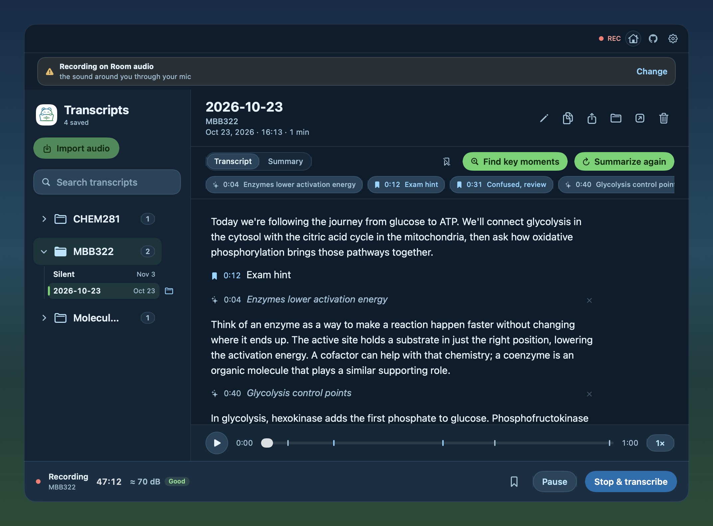
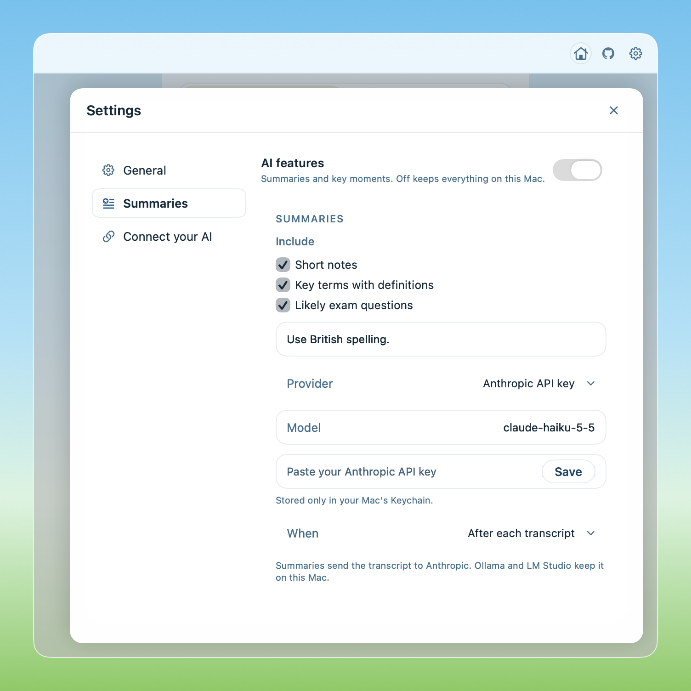

# Nosy

Free, open-source lecture and meeting transcription that runs on your Mac. No account or subscription needed.



## Download

[Download Nosy](https://github.com/bardya07/nosy/releases/latest), open the DMG, and drag Nosy to Applications.

Nosy requires **macOS 14 or later** and an **Apple Silicon Mac (M1 or later)**. Allow microphone access to record. Mac audio also requires macOS 14.4 or later and System Audio Recording permission.

During first-time setup, download the speech model (about 1.6 GB). Nosy also downloads a Neural Engine file in the background when the model is ready. Updates are delivered through Sparkle, with automatic update checks.

## What it does

- Record **Room audio** from your microphone, or **Mac audio** from your Mac and microphone together. No bot joins your call. Switch modes during a recording.
- Mark a moment with **⌘M**, and open your **Library** with **⌘L**.
- Save transcripts as Markdown to use in Obsidian, Notion, or any text editor. Import existing audio to transcribe it too.
- Pick a subject and add course terms to improve vocabulary, or use **Auto** to choose a subject from context.
- Choose **Fast** or **Detailed** transcription. Nosy uses the Neural Engine when its encoder is available.
- By default, audio for successfully transcribed recordings is eligible for deletion after 14 days when the transcript is still readable; transcripts remain. You can change the retention period in Settings. Unfinished audio is kept.



## Optional AI

AI features are off by default. Turn them on in Settings to make summaries with notes, key terms, and exam questions, find key moments, or clean up vocabulary. Choose a provider:

- Download **Qwen3 4B** or **SmolLM3 3B** to run offline.
- Use **Claude Code**, **Codex**, or **Gemini CLI**; **Ollama** or **LM Studio**; or your own **OpenAI**, **Anthropic**, or **Gemini** API key. API keys are stored only in your Mac's Keychain.



## Claude Desktop connector

Nosy's read-only connector lets Claude Desktop list folders, list and read transcripts, and search them. In Nosy, open **Settings → Add to Claude Desktop → Restart Claude Desktop**. Then try: “Summarize my latest lecture.”

## Screenshots

- Home: [Room audio, light](preview/nosy.workspace-home-room.light.png) · [dark](preview/nosy.workspace-home-room.dark.png) | [Mac audio, light](preview/nosy.workspace-home-mac.light.png) · [dark](preview/nosy.workspace-home-mac.dark.png)
- Library while recording: [light](preview/nosy.workspace-library-recording.light.png) · [dark](preview/nosy.workspace-library-recording.dark.png)
- Settings and updates: [light](preview/nosy.workspace-settings-home.light.png) · [dark](preview/nosy.workspace-settings-home.dark.png) | AI: [light](preview/nosy.workspace-ai-on.light.png) · [dark](preview/nosy.workspace-ai-on.dark.png)

## Privacy

Recordings and transcripts stay on your Mac unless you choose to share them. Nosy connects to download models and check for updates. If you enable AI, the provider you choose may receive transcript content; local models can run offline. Claude Desktop can also read transcripts when you connect it, and its own service may receive the content you ask it to use.

## Build from source

On an Apple Silicon Mac, install Xcode command line tools and CMake, then run:

```sh
git clone https://github.com/bardya07/nosy.git
cd nosy
./scripts/build-whisper.sh
./scripts/build-llama.sh
./build.sh
```

The build script fetches Sparkle if needed and prints the path to `Nosy.app`. The default build is ad-hoc signed.

## License

[MIT](LICENSE). See [third-party notices](THIRD_PARTY_NOTICES.md) for bundled components and models.

Made by a student.
