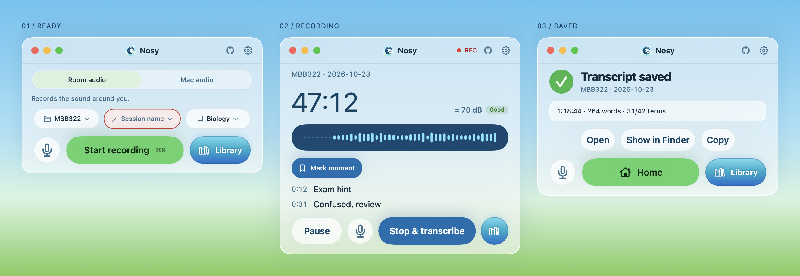
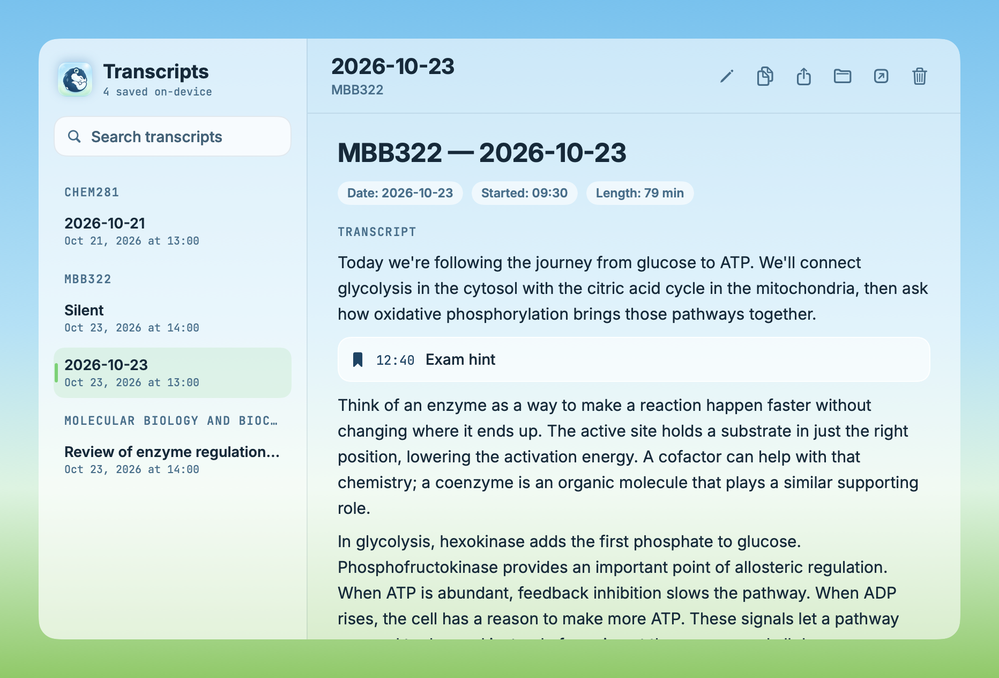

# Nosy

An on-device lecture recorder and transcriber for Mac.




## Features

- Record, pause, and resume lectures; queue transcription while recording another.
- Search, edit, export, and play back recordings in the transcripts window.
- Add custom vocabulary for each course.
- Automatically boost quiet audio for transcription.
- Transcription, volume boost, and audio compression run at background utility priority.
- Transcription waits or pauses when the Mac is hot or on battery below 20%, then resumes automatically. Recording continues independently.
- Sleep prevention, recording-stall detection, and crash recovery protect long sessions. Keep the lid open while recording.
- Import M4A/WAV audio; optionally compress retained recordings to M4A.
- Native light and dark themes.

## Privacy

Recording and transcription are 100% on-device. Nothing you record, transcribe, or add to your vocabulary is uploaded. Initial setup downloads the speech models; after setup, transcription works offline.

## Requirements and setup

- macOS 14.0 or later.
- Apple Silicon (arm64).

Nosy includes whisper.cpp with Metal acceleration. No Homebrew or separate speech engine installation is needed to use the app.

Open Nosy and download the Whisper large-v3-turbo model (about 1.6 GB) in the setup window. Allow microphone access to record. Choose a lecture and session, then start recording or drop an audio file onto the window.

Use **Vocabulary** to add course terms, or put a `vocab.txt` in the course's transcript folder. Put the most useful terms first: Nosy fits complete terms into a 160-token prompt, reused across decoder windows without carrying decoded text. whisper.cpp omits this prompt during high-temperature fallback and the final short tail; see the [lecture validation](tests/vocabulary.md). Choose the transcript location and audio retention in Settings.

## Build from source

Use a compatible Xcode Swift 6 toolchain with the macOS 26 SDK or later, plus CMake (`brew install cmake` if needed). No Xcode project or third-party Swift packages are required.

```sh
./scripts/build-whisper.sh
./build.sh
```

The engine script downloads the pinned whisper.cpp **v1.9.5** source tarball into `vendor/cache/`, verifies its SHA-256, and builds only `whisper-cli` for arm64 with a macOS 14 deployment target. GGML/Whisper libraries are statically linked, Metal shaders are embedded in the executable, and only Apple system libraries are loaded. OpenMP, SDL, and network downloads in the CLI are disabled. The binary is written to the gitignored `vendor/whisper/`; models continue to download in the app.

The app is written to `~/Library/Caches/Nosy Build/Nosy.app`. Set `BUILD_DIR` to change the output directory. `build.sh` copies the helper to `Contents/Helpers/whisper-cli` and signs it before signing the app, both with hardened runtime. Builds use ad-hoc signing by default; set `NOSY_CODESIGN_IDENTITY` to a Developer ID Application identity for distribution (requires a valid identity and secure timestamp; signing failures stop the build). Signing prepares the bundle for notarization; it does not submit it to Apple's notary service.

Packaged apps always use their bundled engine. Unbundled development/test executables can use `NOSY_WHISPER_CLI`, then PATH or the usual Homebrew locations.

To build and install in `/Applications` (quits and replaces an existing Nosy installation):

```sh
./build.sh install
```

## Tests

```sh
tests/run_unit.sh
tests/run_pipeline.sh
```

Unit tests use temporary fixtures and a mock transcription CLI, including checks for bundled-engine resolution. Build the engine and app before running the pipeline test; it uses the helper from the built app plus a downloaded model. It synthesizes speech into a file (or uses the pinned source's JFK sample in restricted runners) and runs real transcription in temporary directories. Neither command plays audio. The pipeline waits until the model download is complete.

See [SPEC.md](SPEC.md) for the historical development specification.

## Roadmap

Bigger STEM vocabulary support (packs in Resources/Vocabulary).

The [vocabulary packs](Resources/Vocabulary/SOURCES.md) are development data and are not yet used by the app.

## License

Nosy is [MIT licensed](LICENSE). Fonts and other third-party materials retain their own terms; see [THIRD_PARTY_NOTICES.md](THIRD_PARTY_NOTICES.md) and [vocabulary sources](Resources/Vocabulary/SOURCES.md).
