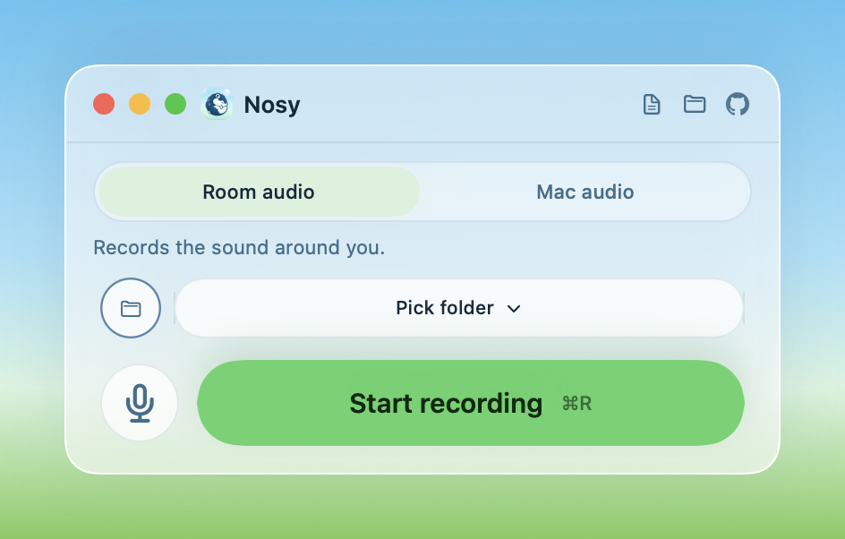
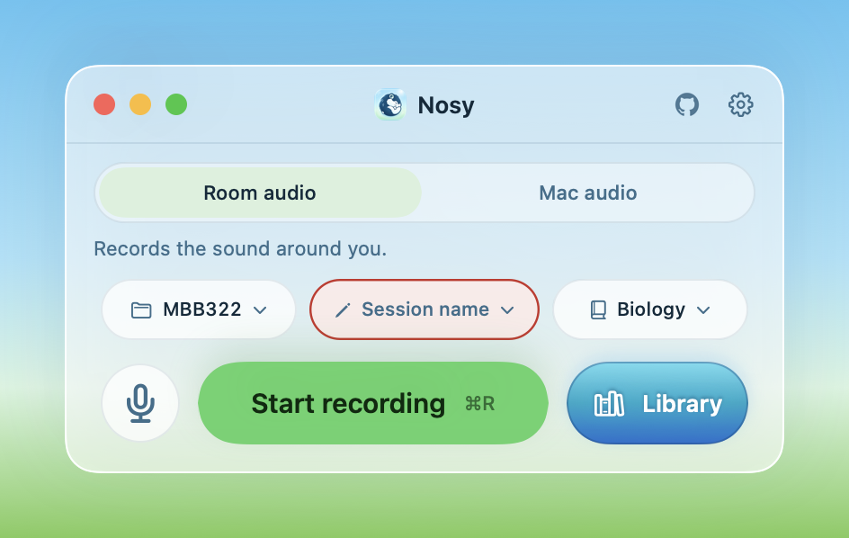
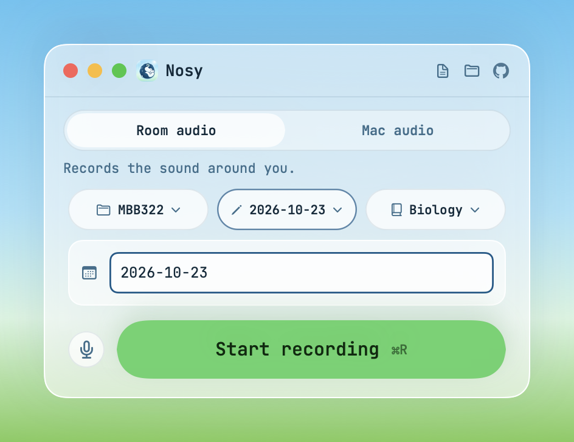
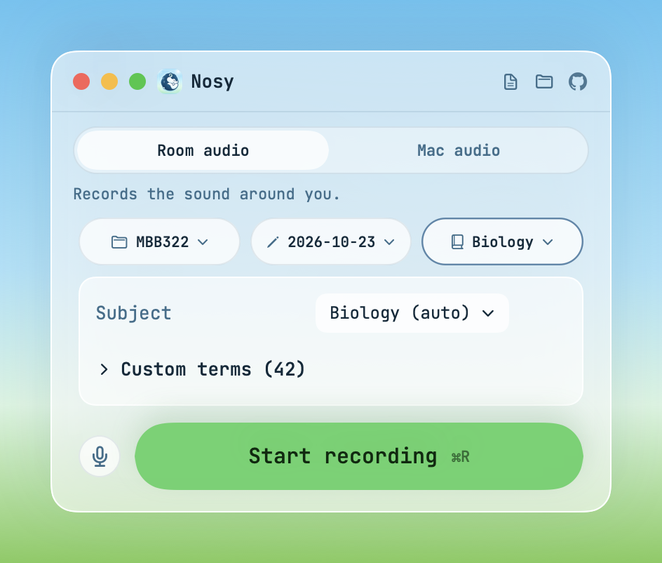

# Nosy

Private, on-device recording and transcription for lectures and meetings.

## Record

Choose **Room audio** to capture your microphone, or **Mac audio** to capture your microphone and Mac audio. Mac audio requires **System Audio Recording** permission and macOS 14.4 or later.

Choose where to **Save to**, name the **Session**, and select **Vocab**. Use the circular calendar button to enter today's date as a session name. Pick a folder from the Save to wheel, or choose a destination there too. Vocabulary options include **Auto**, **General**, and subject packs, including **Meetings & Work**. Auto chooses packs from the folder name or course and meeting keywords.

Press **⌘M** or click **Mark moment** while recording to add a timestamped marker. Use **Library** beside Start recording, or **⌘L**, to browse past saves in the same window. The **← Nosy** button returns to compact Home. Recording continues while you browse, with controls along the bottom of Library. The title bar gear and **⌘,** open Settings over the current mode.

Nosy transcribes on your Mac. Your recordings, transcripts, and vocabulary stay on your device.

## Download

Download the notarized DMG from [Nosy Releases](https://github.com/bardya07/nosy/releases), open it, and drag Nosy to Applications. Nosy includes whisper.cpp; Homebrew is not needed.

Requires macOS 14 or later and Apple Silicon. The first launch downloads the speech model. Allow microphone access for recording; allow System Audio Recording for Mac audio mode.

## Previews

More interface states are available in the [preview folder](preview/), including dark mode, Room audio and Mac audio modes, each main control menu, Settings, onboarding, and recording activity.

## License

Nosy is [MIT licensed](LICENSE). Third-party materials retain their own terms; see [THIRD_PARTY_NOTICES.md](THIRD_PARTY_NOTICES.md).
