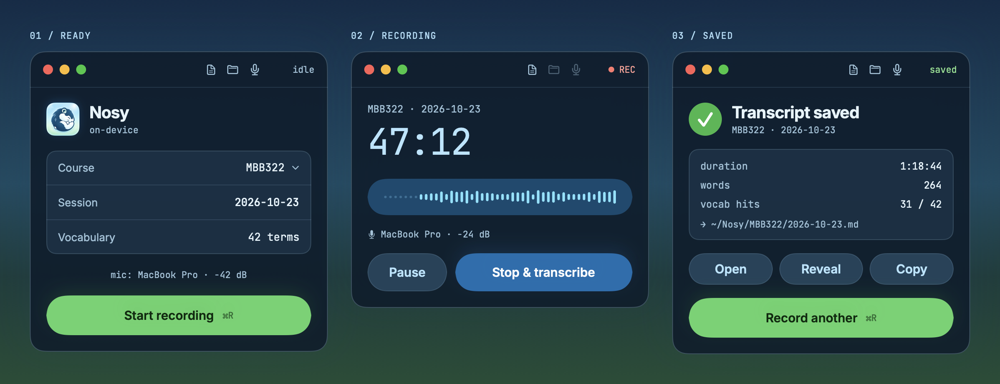
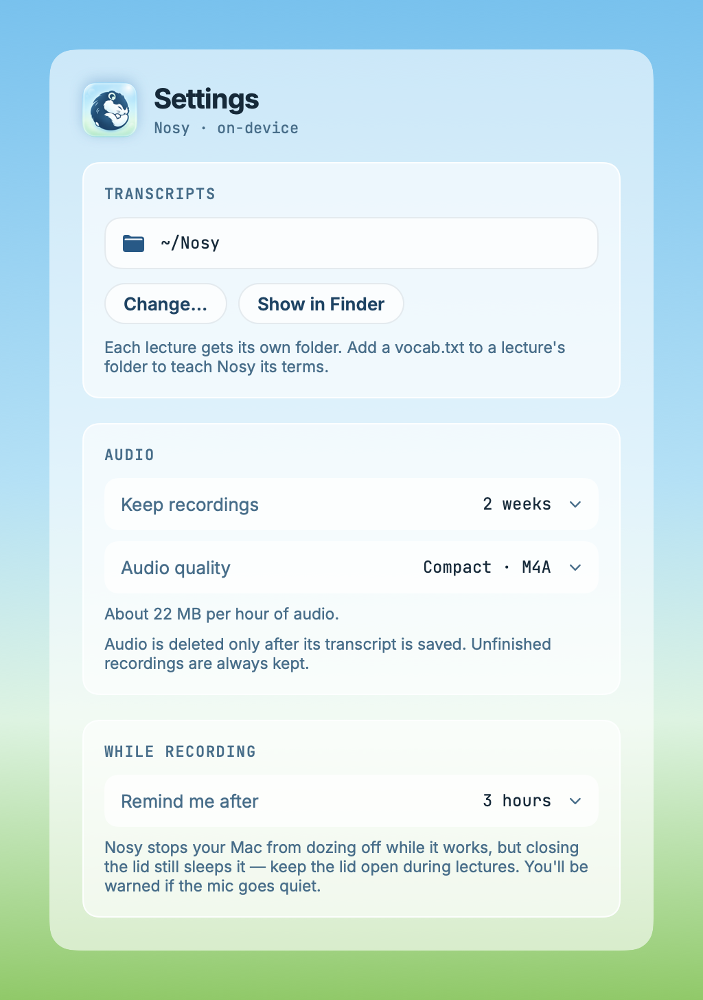
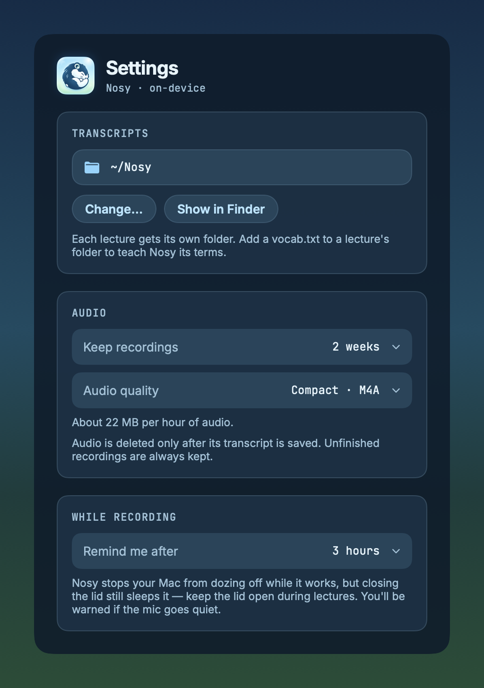
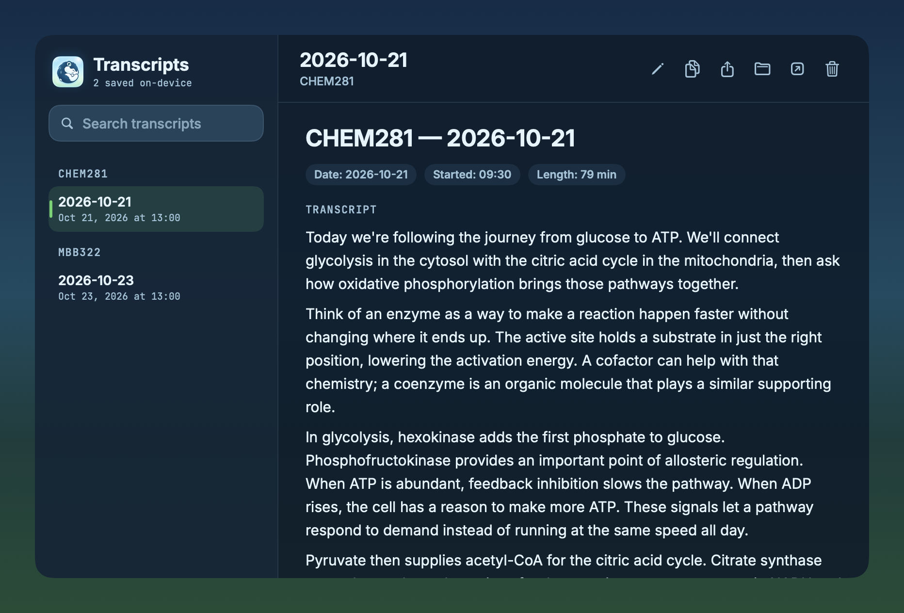
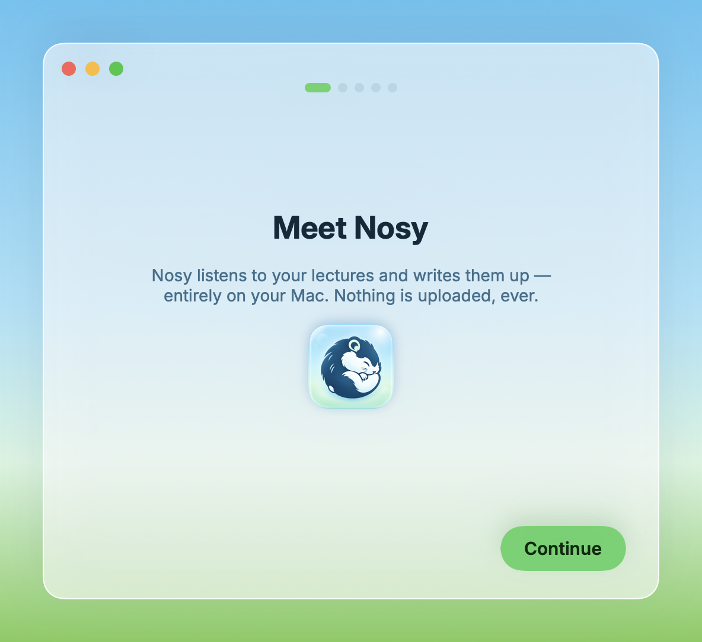
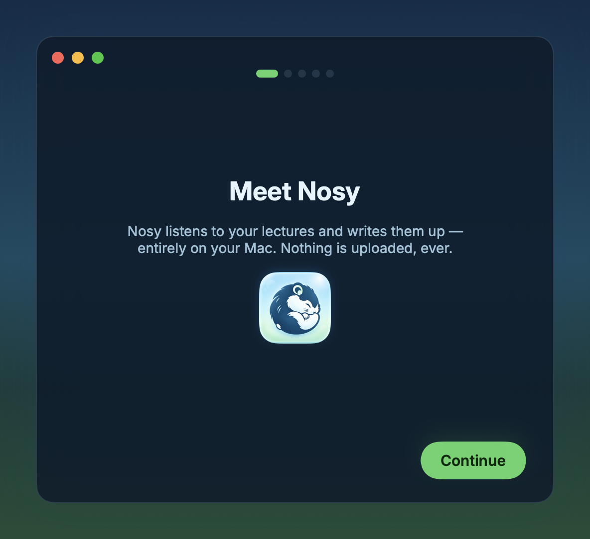
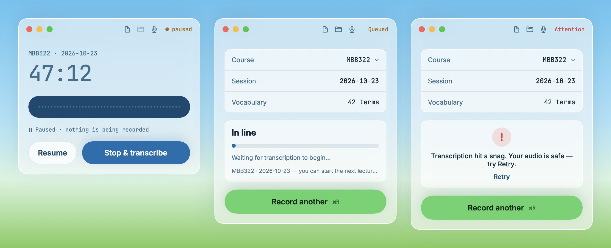
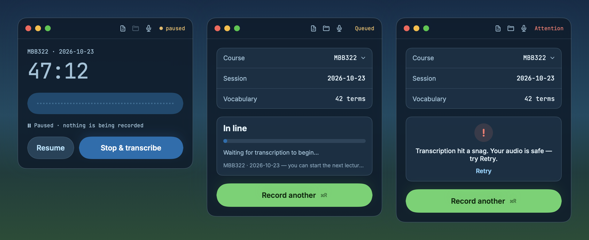

# Nosy

An on-device lecture recorder and transcriber for Mac.





<details>
<summary>Settings, onboarding, and additional states</summary>









</details>

## Features

- Record, pause, and resume lectures; queue transcription while recording another.
- Search, edit, export, and play back recordings in the transcripts window.
- Add custom vocabulary for each course.
- Automatically boost quiet audio for transcription.
- Transcription, volume boost, and audio compression run at background utility priority.
- Transcription waits or pauses when the Mac is hot or on battery below 20%, then resumes automatically. Recording continues independently.
- Sleep prevention, recording-stall detection, and crash recovery protect long sessions. Keep the lid open while recording.
- Import M4A/WAV audio; optionally compress retained recordings to M4A.
- Native light and dark themes.

## Privacy

Recording and transcription are 100% on-device. Nothing you record, transcribe, or add to your vocabulary is uploaded. Initial setup downloads the speech models; after setup, transcription works offline.

## Requirements and setup

- macOS 14.0 or later.
- Apple Silicon recommended; the current build script produces an arm64 app.
- [Homebrew](https://brew.sh/) and whisper.cpp:

```sh
brew install whisper-cpp
```

Open Nosy and download the Whisper large-v3-turbo model (about 1.6 GB) in the setup window. Allow microphone access to record. Choose a lecture and session, then start recording or drop an audio file onto the window.

Use **Vocabulary** to add course terms, or put a `vocab.txt` in the course's transcript folder. Put the most useful terms first: Nosy fits complete terms into a 160-token prompt, reused across decoder windows without carrying decoded text. whisper.cpp omits this prompt during high-temperature fallback and the final short tail; see the [lecture validation](tests/vocabulary.md). Choose the transcript location and audio retention in Settings.

## Build from source

Use a compatible Xcode Swift 6 toolchain with the macOS 26 SDK or later. No Xcode project or third-party Swift packages are required.

```sh
./build.sh
```

The app is written to `~/Library/Caches/Nosy Build/Nosy.app`. Set `BUILD_DIR` to change the output directory. Builds use ad-hoc signing by default; set `NOSY_CODESIGN_IDENTITY` to a local code-signing identity to use it, with ad-hoc fallback if signing fails.

To build and install in `/Applications` (quits and replaces an existing Nosy installation):

```sh
./build.sh install
```

## Design previews

Design E uses native macOS vibrancy, Inter and JetBrains Mono (bundled under OFL 1.1), navy text, green primary actions, and a blue Stop action. Dark mode uses the same hues over deep navy surfaces. Utility buttons, recovery banners, transcription queues, and the Dock controls remain available. Markers are deferred to a later change.

Regenerate the light/dark sheets and individual Ready, Recording, Saved, Transcripts, Settings, and onboarding PNGs in `preview/`:

```sh
BUILD_DIR="$PWD/build" ./build.sh
build/Nosy.app/Contents/MacOS/Nosy --headless-snapshot preview/nosy.png
```

The headless renderer uses isolated sample transcripts and the sky-to-grass fallback backdrop, without recording, playing audio, downloading models, or loading the user's transcript library. The real window uses native vibrancy. Idle microphone levels show `— dB` because input monitoring currently begins with recording. Saved vocabulary hits count distinct configured terms found in the transcript, rather than decoder corrections. The Vocabulary count currently reflects custom terms; `CourseVocabularySummary` in `App.swift` is the UI adapter for the concurrent subject-pack integration.

## Tests

```sh
tests/run_unit.sh
tests/run_pipeline.sh
```

Unit tests use temporary fixtures and a mock transcription CLI. The pipeline test needs whisper.cpp and a downloaded model; it synthesizes speech into a file and runs real transcription in temporary directories. Neither command plays audio. The pipeline waits until the model download is complete.

See [SPEC.md](SPEC.md) for the historical development specification.

## Roadmap

Bigger STEM vocabulary support (packs in Resources/Vocabulary).

The [vocabulary packs](Resources/Vocabulary/SOURCES.md) are development data and are not yet used by the app.

## License

Nosy is [MIT licensed](LICENSE). Fonts and other third-party materials retain their own terms; see [THIRD_PARTY_NOTICES.md](THIRD_PARTY_NOTICES.md) and [vocabulary sources](Resources/Vocabulary/SOURCES.md).
